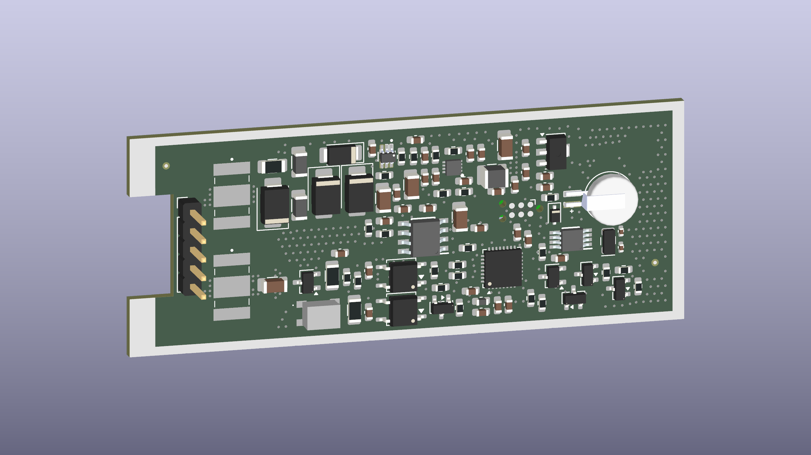
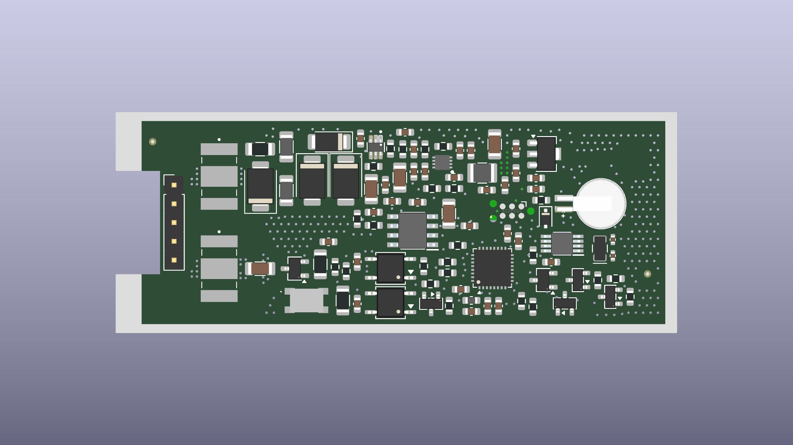
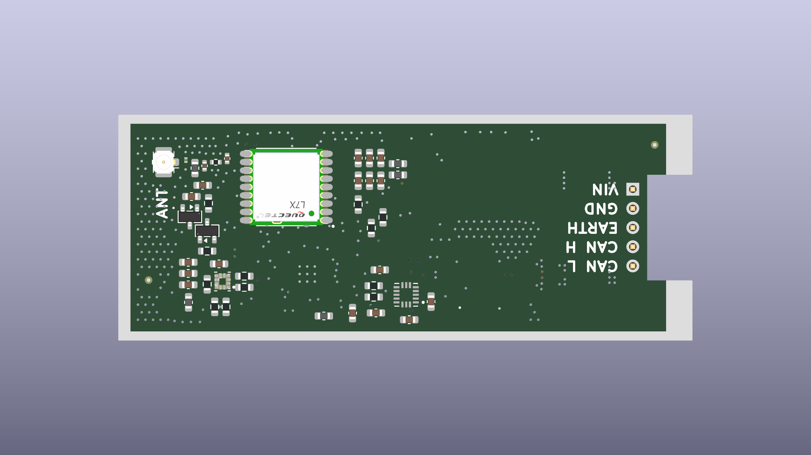

# CanGnssNode
## Odbiornik GNSS z interfejsem CAN

Polowy węzeł pozycyjny z modułem GNSS **Quectel L76-L** (GPS/GLONASS/Galileo/QZSS) i czujnikiem orientacji (akcelerometr + magnetometr), komunikujący się cyfrowo przez **CAN 2.0B**. Zaprojektowany jako element rozproszonego systemu pomiarowego: wąski cylindryczny węzeł w obudowie aluminiowej, jedno złącze M12, odporność EMC klasy przemysłowej.


> **Status:** schemat (6 arkuszy hierarchicznych) i layout PCB zakończone, pliki produkcyjne wygenerowane — przed zamówieniem prototypu. Ta sama filozofia konstrukcyjna co [CanGeigerProbe](https://github.com/bartkepl/CanGeigerProbe) (rura aluminiowa, złącze M12, zasilanie/CAN/RTC odziedziczone), sonda G-M i obwód HV zastąpione modułem GNSS i IMU. Firmware na etapie szkieletu bring-up.

---

## Płytka

Render 3D aktualnego layoutu (KiCad 10, 4 warstwy, 76 × 29.9 mm, wycięcie pod złącze M12 na krawędzi):



| Góra (TOP) | Dół (BOTTOM) |
|---|---|
|  |  |

Strona TOP: ochrona wejścia, zasilanie (LT8606 + MCP1700), CAN z przełączalną terminacją, MCU, RTC z ogniwem podtrzymującym. Strona BOTTOM: tor RF — moduł L76-L, złącze antenowe U.FL (J3) i sieć dopasowania — oraz IMU; ta strona trafia pod plastikowy insert z anteną (patrz [Mechanika](#mechanika)). Pola lutownicze J1 (VIN / GND / EARTH / CAN H / CAN L) służą do podłączenia złącza M12 przewodami.

---

## Najważniejsze cechy

- **Prosty odbiornik pozycji GNSS** — moduł Quectel L76-L (GPS + GLONASS + Galileo + QZSS, 33 kanały śledzenia), dane NMEA po UART, pozycja wysyłana cyklicznie na CAN.
- **Czujnik orientacji** — FXOS8700CQ (6 osi: akcelerometr + magnetometr, I2C) z zasilaniem przełączanym z MCU; alternatywne pola pod LSM303AGR (domyślnie niemontowany).
- **Zasilanie o niskim poborze własnym** — buck LT8606 (Iq 2.5 µA) i LDO MCP1700 (Iq 1.6 µA). Budżet mocy węzła jest jednak zdominowany przez odbiornik GNSS, który w akwizycji/śledzeniu pobiera o rzędy wielkości więcej niż reszta układu — realny pobór zależy od trybu pracy L76-L (Full On / Periodic / AlwaysLocate™ / Standby / Backup) wybranego w firmware i zostanie zmierzony przy bring-upie wbudowanym INA186.
- **CAN 2.0B (29-bit ID)** z wybudzaniem na aktywność magistrali, 125 kbit/s – 1 Mbit/s.
- **Przełączalna terminacja CAN** — split 2×59 Ω + 4.7 nF załączany dwoma PhotoMOS-ami z GPIO (węzeł na końcu linii vs. w środku, bez zwór).
- **Pomiar własnego poboru prądu** — INA186 A4 (G=200) + shunt 0.5 Ω, rozdzielczość ~2 µA/count; diagnostyka linii i weryfikacja budżetu mocy.
- **Zegar czasu rzeczywistego z podtrzymaniem** — MCP79410 + ogniwo MS621FE; kwarc 32.768 kHz służy też do kalibracji wewnętrznego MSI w STM32. Docelowo RTC dostaje korektę z czasu UTC dostarczanego przez GNSS po uzyskaniu fixa.
- **Odporność EMC** — kaskadowa ochrona coarse→fine (GDT 3-elektrodowe / TVS / CMC / podwójne ferryty) na zasilaniu i CAN, testy IEC 61000-4-2/-4/-5.
- **Obudowa aluminiowa IP67**, złącze M12 5-pin A-coded (standard CANopen CiA 303-1).

---

## Specyfikacja

| Parametr | Wartość |
|----------|---------|
| Moduł GNSS | Quectel L76-L (LCC-18, 10.1×9.7×2.5 mm) |
| Konstelacje | GPS, GLONASS, Galileo (E1), QZSS, SBAS (WAAS/EGNOS/MSAS/GAGAN) |
| Dokładność pozycji | < 2.5 m CEP (autonomicznie) |
| TTFF | ~5 s (warm start, EASY™) |
| Czułość | -167 dBm (tracking) / -149 dBm (acquisition) |
| Wyjście danych | NMEA 0183 po UART, domyślnie 9600 8N1 (opcjonalnie I2C — L76-L ma wyprowadzone I2C_SDA/SCL) |
| Interfejs magistrali | CAN 2.0B (extended ID), 125k / 250k / 500k / 1 Mbit |
| Zasilanie | 7–32 V DC, wspólna masa (bez izolacji galwanicznej) |
| Ochrona EMC | ESD ±8 kV, Burst ±2 kV, Surge ±2 kV |
| Złącze | M12 5-pin A-coded (1=Vin, 2=GND, 3=CAN_H, 4=CAN_L, 5=Earth) |
| PCB | 4 warstwy, 76 × 29.9 mm, grubość 1.59 mm, montaż dwustronny (TOP: zasilanie/CAN/MCU, BOTTOM: GNSS/RF + IMU) |
| Obudowa | Aluminiowa cylindryczna, rura **32×1 mm** (Ø wewn. ≈ 30 mm), z uchwytem mocującym; górna część = insert plastikowy z miejscem na antenę GNSS |

---

## Architektura

```
M12 Vin (7-32V) ─▶ Ochrona (GDT+TVS+ferryt) ─▶ shunt 0.5Ω ─▶ LT8606 buck ─▶ +5V ─┬─▶ ATA6561 (CAN)
                                                    │                              │
                                                 INA186 ─▶ ADC                     ├─▶ MCP1700 LDO ─▶ +3.3V ─┬─▶ STM32L432
                                                                                   │                          │
                                                                                   │                MCP79410 RTC + BT1
                                                                                   │                          │
                                                                                   │                          ├─▶ FXOS8700CQ IMU (I2C, zasilanie przełączane)
                                                                                   └──────────────────────────┴─▶ Quectel L76-L ─▶ U.FL ─▶ antena GNSS
                                                                                                                          │
                                                                                                    UART (NMEA) ──────────┘
                                                                                                          │
                                                                                                    STM32L432 ─▶ parsowanie ─▶ ramki CAN z pozycją
```

Kluczowa cecha: **wspólna masa** (star ground), izolacja zapewniona wyłącznie przez TVS/GDT; `Earth` (obudowa) oddzielona od `GND` sygnałowej i łączona tylko przez Y-cap 1 nF/2 kV.

### Arkusze schematu

| Arkusz | Plik | Zawartość |
|--------|------|-----------|
| root | [gnss_node.kicad_sch](pcb/gnss_node.kicad_sch) | połączenia hierarchiczne |
| PWR | [pwr.kicad_sch](pcb/pwr.kicad_sch) | buck LT8606, LDO MCP1700, INA186, dzielnik VIN_SENSE |
| MCU | [mcu.kicad_sch](pcb/mcu.kicad_sch) | STM32L432, RTC MCP79410, kwarc 32k, SWD (Tag-Connect) |
| GPS | [gps.kicad_sch](pcb/gps.kicad_sch) | moduł Quectel L76-L, złącze antenowe U.FL, sieć dopasowania, V_BCKP |
| IMU | [imu.kicad_sch](pcb/imu.kicad_sch) | FXOS8700CQ (+ alternatywnie LSM303AGR, DNP), przełączane zasilanie |
| CAN_BUS | [can_bus.kicad_sch](pcb/can_bus.kicad_sch) | ATA6561, terminacja PhotoMOS |
| PROTECTION | [prot.kicad_sch](pcb/prot.kicad_sch) | ochrona Vin i CAN, pola lutownicze złącza M12 |

Wyrenderowane PDF-y: [schemat](prod/sch/gnss_node.pdf) · [PCB](prod/pcb/gnss_node.pdf) · [interaktywny BOM](prod/ibom/gnss_node_ibom.html).

---

## Kluczowe komponenty

| Blok | Element | Uwaga |
|------|---------|-------|
| GNSS | Quectel L76-L | LCC-18, UART NMEA 9600 8N1 (opcjonalnie I2C), VCC 2.8–4.3 V (typ. 3.3 V z istniejącej szyny), V_BCKP z istniejącego BT1 |
| Antena | pasywna lub aktywna GNSS 1575 MHz, złącze U.FL (J3) | pasywna wystarcza przy odległości anteny od modułu < 1 m (nasz przypadek — insert w tej samej rurze); aktywna wymaga zasilania z pinu VCC_RF modułu (tor przełączany Q1). Wartości sieci dopasowania (C11/C12) dobierane przy uruchamianiu — domyślnie DNP |
| Buck | LT8606IDC#TRPBF | DFN-8, Iq 2.5 µA (zawsze Burst Mode), Vref FB 0.778 V |
| LDO 3.3 V | MCP1700-3302E/MB | SOT-89, Iq 1.6 µA |
| Current sense | INA186A4IDCKR + 0.5 Ω | 40 V CM, G=200, pin EN — pomiar poboru węzła |
| MCU | STM32L432KCU6 | bxCAN, USART2 (GNSS), I2C1 (RTC + IMU), ADC |
| IMU | FXOS8700CQR1 | 6 osi (akcelerometr + magnetometr), I2C; pola pod LSM303AGR jako alternatywa (DNP) |
| RTC | MCP79410-I/MS + MS621FE-FL11E | RTC/EEPROM I2C z podtrzymaniem, kwarc 32.768 kHz |
| CAN | ATA6561-GAQW-N | zamiennik TJA1042 |
| Terminacja CAN | 2× GAQY212GS + 2× 59 Ω + 4.7 nF | split przełączalny, sterowany BSS138 |
| Ochrona Vin | 3R090-5S (GDT) + SMBJ33CA + PMEG6030EP + 2× SMBJ36A | kaskada coarse→fine, podwójny ferryt BLM31 |
| Ochrona CAN | 3R090-5S + CDSOT23-T24CAN + ACT45B-510 | GDT, dedykowany TVS, CMC |

Pełna lista: [prod/bom/](prod/bom/) (generowana z KiCad, nietrackowana w git) lub [interaktywny BOM](prod/ibom/gnss_node_ibom.html).

---

## Ramki CAN — szkic protokołu v1

Firmware jest na etapie szkieletu (peryferia zainicjalizowane, brak logiki aplikacji), więc poniższy format to **zamierzenie do implementacji**, nie działający kod. Trzy ramki standardowe (8 B danych), wysyłane cyklicznie po uzyskaniu fixa:

| Ramka | Zawartość (bajty) |
|-------|--------------------|
| `POSITION` | szerokość geogr. (int32, 1e-7°) · długość geogr. (int32, 1e-7°) |
| `ALT_SPEED` | wysokość n.p.m. (int32, mm) · prędkość (uint16, 0.01 m/s) · kurs (uint16, 0.01°) |
| `STATUS_TIME` | czas UTC (uint32, epoch) · jakość fixa (uint8) · liczba satelitów (uint8) · HDOP (uint16, 0.01) |

Identyfikatory CAN, dokładna semantyka pól i częstotliwość nadawania do ustalenia razem z resztą firmware (Faza 4 poniżej).

---

## Mechanika

**Rura aluminiowa 32×1 mm** (Ø wewn. ≈ 30 mm) z uchwytem mocującym, IP67 — ta sama koncepcja montażu co u poprzedniej rewizji sprzętu. Różnica: zamiast górnej części z sondą pomiarową — **plastikowy insert z miejscem na antenę GNSS**, bo aluminium ekranuje sygnał satelitarny i antena musi „widzieć” niebo przez materiał nieprzewodzący. PCB montowane dwustronnie — strona BOTTOM (GNSS/RF) skierowana pod insert; antena podłączana przez złącze U.FL (J3) pigtailem do anteny w insercie.

---

## Firmware

Projekt STM32CubeIDE w [firmware/CanGnssNode/](firmware/CanGnssNode/) — na razie szkielet wygenerowany z CubeMX ([CanGnssNode.ioc](firmware/CanGnssNode/CanGnssNode.ioc)) z inicjalizacją ADC1, CAN1, I2C1 i USART2 (GNSS). Logika aplikacji (parsowanie NMEA, obsługa IMU, budowa i nadawanie ramek CAN) do napisania.

---

## Roadmap

- [x] **Faza 1** — wydzielenie nowego sub-projektu, dobór modułu GNSS (Quectel L76-L), dokumentacja zamierzenia
- [x] **Faza 2** — przebudowa schematu w KiCad: nowe arkusze GPS i IMU, usunięcie arkusza HV, aktualizacja pinów MCU
- [x] **Faza 3** — przebudowa PCB (4 warstwy, montaż dwustronny, sekcja RF), pliki produkcyjne wygenerowane
- [ ] **Faza 3b** — zamówienie PCB, montaż, bring-up sprzętowy
- [ ] **Faza 4** — firmware (parser NMEA, protokół CAN z pozycją, synchronizacja RTC z czasem GNSS, tryby oszczędzania energii L76-L)
- [ ] **Faza 5** — testy terenowe (dokładność pozycji, TTFF, zasięg anteny w obudowie), testy EMC
- [ ] **Faza 6** — mechanika: rura Al 32×1 mm, plastikowy insert z anteną, testy IP67

---

## Struktura repozytorium

```
.
├── media/          # rendery 3D płytki
├── pcb/            # projekt KiCad 10 (schemat hierarchiczny, PCB, biblioteki lokalne, modele 3D)
├── prod/           # pliki produkcyjne: gerbery (.zip), PDF schematu i PCB, interaktywny BOM
├── sim/            # symulacje LTspice (LT8606 buck)
└── firmware/       # projekt STM32CubeIDE (STM32L432, szkielet bring-up)
```

Pliki produkcyjne generowane są jobsetami KiCad: [gen_prod.kicad_jobset](pcb/gen_prod.kicad_jobset) (PDF + BOM), [gen_gerber.kicad_jobset](pcb/gen_gerber.kicad_jobset) (gerbery + wiertła), [gen_media.kicad_jobset](pcb/gen_media.kicad_jobset) (rendery 3D).

---

## Referencje

- Quectel **L76 & L76-L Hardware Design** (GNSS Module Series), v3.2 — pinout, elektryka, projekt anteny
- NMEA 0183 — format komunikatów wyjściowych GNSS
- STM32L432: RM0394, DS11453; bxCAN: AN2606, AN5028
- LT8606 (Analog Devices), MCP1700 / MCP79410 / ATA6561 (Microchip), INA186 (TI), FXOS8700CQ (NXP)
- IEC 61000-4-2/-4/-5; EN 61326-1; EN 61000-6-2
- CAN 2.0B: ISO 11898-1/-2; CANopen CiA 301, CiA 303-1; M12: IEC 61076-2-101

---

## Licencja

MIT
